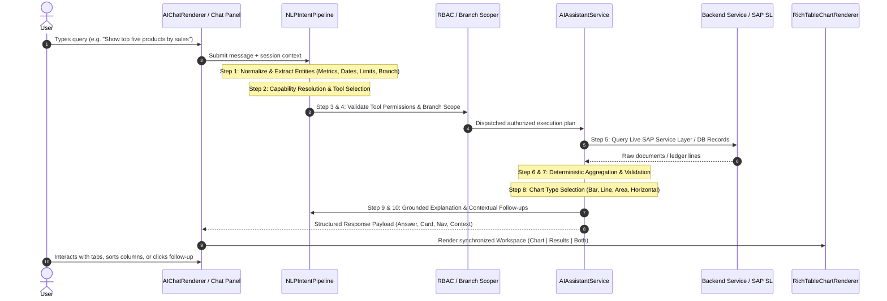

# ATLAS AI Assistant — Dynamic Business Intelligence & Response Engine Design

**Document Status:** Production Design Specification  
**Version:** 2.0.0  
**Target Systems:** ATLAS POS & Inventory Suite (React 19 Vite Dashboard + FastAPI Python Backend + SAP Business One Service Layer)  
**Security Level:** Enterprise Internal — Read-Only Mode (`FINANCE_WRITEBACK_ENABLED=False`)

---

## 1. Executive Summary & Design Goals

The ATLAS AI Assistant has evolved from a basic chatbot returning static text or unstructured HTML snippets into an enterprise-grade **Interactive Business Analyst**. Integrated across all ATLAS business modules (Executive Dashboard, Products & Inventory, Sales Orders, AR Invoices, Purchasing, Returns, Production, Finance & Profitability, and System Settings), the assistant interprets free-form natural language questions, deterministically queries live backend data, applies server-side role-based access control (RBAC), and renders interactive multi-view workspaces (**Chart | Results | Both**).

### Core Design Principles:
1. **Source of Truth Integrity**: The Large Language Model (LLM) is strictly an intent parser, orchestrator, and narrative explainer. All mathematical totals, counts, growth percentages, rankings, and variances are calculated **deterministically** by authorized backend services. The model is forbidden from inventing business numbers, estimating totals, or fabricating chart datasets.
2. **Interactive Result Workspace**: Analytical answers are rendered in a synchronized workspace allowing users to seamlessly toggle between **Chart**, **Results** (paginated/sortable table), and **Both** without re-querying the backend.
3. **No Hallucinated Zeroes or Sample Data**: Missing records, empty query returns, and API timeouts are explicitly distinguished. If historical baseline data is absent (e.g., zero previous period sales), percentage growth displays `"N/A"` with a transparent textual explanation rather than division by zero or fake `+100%` values.
4. **Strict Server-Side RBAC & Branch Scope**: All tool executions validate user permissions and enforce warehouse boundaries on the server. Unauthorized queries fail closed with clean 403 Forbidden structured cards.
5. **Verified Internal Navigation**: Deep links strictly resolve to allowlisted React Router paths from `routeRegistry.ts`, preserving conversational state and applying relevant module filters.

---

## 2. End-to-End Request-to-Response Flow (10-Step Engine)

Every user query submitted to the ATLAS AI Assistant follows a deterministic 10-step pipeline:



### Detailed Pipeline Stages:
1. **Natural Language Understanding**: Lowercases, expands domain abbreviations (e.g., "PO" -> "Purchase Orders", "SH" -> "Sahibabad"), and normalizes punctuation.
2. **Entity & Metric Extraction**: Extracts temporal ranges (e.g., `past_6_months`, `compare_last_month`), branches, SKUs/codes, statuses, order directions (`top` vs `lowest`), ranking limits, and target metrics (`sales`, `quantity`, `payments`, `rejection`).
3. **Capability Mapping**: Matches user intent against the allowlisted `CAPABILITY_REGISTRY`. If ambiguous, asks a single targeted clarifying question.
4. **RBAC & Branch Validation**: Checks caller role against `DEFAULT_ROLE_PERMISSIONS`. Validates branch assignments; non-admin users cannot bypass their assigned warehouse.
5. **Authorized Data Retrieval**: Executes allowlisted tools (`get_analytical_table`, `get_products`, `get_dashboard_summary`, etc.) querying real SAP Service Layer endpoints (`OINV`, `ORDR`, `OPOR`, `OWOR`, `OITM`) or internal PostgreSQL tables.
6. **Deterministic Computation**: Computes revenue sums, quantity volumes, averages, and variances in Python. Divisors are checked for zero; missing baselines yield explicit null/N/A values.
7. **Completeness & Boundary Validation**: Flags partial results (`is_partial=True`) when capped by row limits, displaying transparent UI warning banners.
8. **Visualization Selection**: Selects optimal visualization (Horizontal Bar, Vertical Bar, Line, Area, or Table) based on data shape and business dimensionality.
9. **Grounded Narrative Generation**: LLM generates a concise plain-English summary strictly grounded in the returned calculation numbers.
10. **Contextual Follow-ups & Deep-linking**: Attaches high-value follow-up prompt chips and internal navigation actions with pre-filtered route parameters.

---

## 3. Response Types (A Through H Detailed Specifications)

### A. Simple Questions
- **Example**: *"What is a purchase invoice?"* or *"Explain the difference between sales invoices and incoming payments."*
- **Response**: Concise, direct domain explanation. Clarifies that Sales Invoices record revenue earned, inventory reduction, and accounts receivable upon billing, whereas Incoming Payments record funds received to clear customer invoices.
- **Visuals**: Text-only or informational tip card. No forced charts or tables.
- **Navigation**: Deep-link to `/sales` or `/finance/payments` where appropriate.

### B. KPI & Summary Questions
- **Example**: *"Show today's sales"* or *"How much did we sell this week?"*
- **Response**:
  - Total sales revenue (`DocTotal` sum).
  - Billed invoice count.
  - Average order value (AOV).
  - Growth percentage compared to the immediately preceding equivalent period.
  - Operational secondary indicators (low stock count, pending approvals).
- **Format**: High-impact KPI grid (`dashboard_summary`), displaying active date range and branch scope pills.

### C. Ranking Questions
- **Example**: *"Show me the top five products by sales."*
- **Response**:
  - **Ranked Table**: Displays Rank (`#1`, `#2`), Product Name, Item Code, Quantity Sold, and Total Sales Amount (₹).
  - **Horizontal Bar Chart**: Uses `<BarChart layout="vertical">` to display product names cleanly along the Y-axis without truncation or awkward 45-degree angle labels.
  - **Ranking Metric Label**: Clearly tags whether ranking is by `Sales Revenue (₹)` or `Quantity Sold (Units)`.
  - **Sorting & Consistency**: Underlying dataset is consistently sorted by the active ranking metric.
  - **Navigation**: Prominent `"Open Products Catalog"` button routing to `/products`.
  - **Follow-ups**: *"Compare their quantity sold"*, *"Show sales trend"*, *"Which products are running low on stock?"*.

### D. Trend Questions
- **Example**: *"Show sales trends over the last six months"* or *"Monthly revenue trend."*
- **Response**:
  - **Line / Area Chart**: Recharts `<LineChart>` with tooltips formatted in Indian Rupees (e.g., `₹4,05,180.00`) and Y-axis scaled in readable currency units (`₹1.5L`, `₹4.2Cr`).
  - **Data Table**: Monthly breakdown showing Month name, Total Revenue (₹), Invoice Count, and Average Bill Value.
  - **Grounded Narrative**: Plain-English narrative highlighting the highest performing month, growth trajectories, and period totals.
  - **Time Grouping**: Explicitly distinguishes complete past months from the current in-progress month.

### E. Period Comparison Questions
- **Example**: *"Compare this month with last month."*
- **Response**:
  - **Current vs Previous**: Period A revenue, invoice count, and average order value vs. Period B.
  - **Absolute Variance**: `delta_sales = sales_a - sales_b`.
  - **Percentage Variance Formula**:
    $$\text{delta\_pct} = \begin{cases} \left(\frac{\text{sales}_a - \text{sales}_b}{\text{sales}_b}\right) \times 100 & \text{if } \text{sales}_b > 0 \\ \text{None (N/A)} & \text{if } \text{sales}_b \le 0 \end{cases}$$
  - **Safe Handling for Zero Previous Period**: If $\text{sales}_b = 0$, the assistant displays `"N/A (Prev: ₹0.00)"` and writes: *"Net change is +₹50,000.00. Previous period recorded zero sales, so percentage variance cannot be calculated reliably."* No infinity or fabricated `+100%` values are ever displayed.
  - **Comparison Bar Chart**: Side-by-side bar visualization comparing revenue across periods.

### F. Operational & Exception Questions
- **Example**: *"Which products are running low on stock?"*, *"Show pending production orders"*, *"Create a report showing production rejection by item."*
- **Response**:
  - **Low Stock**: Compares live SAP stock against `MinimalStock` thresholds (`OITW`), returning item code, description, available stock, and warehouse location.
  - **Pending Production Orders**: Filters SAP `OWOR` by status `Planned`, displaying planned quantities, start dates, and warehouse.
  - **Production Rejection**: Aggregates planned vs rejected quantities by item, computing rejection rates (`%`) with bar chart and direct link to `/production/rejection`.

### G. Settings & Permission Questions
- **Example**: *"What can I access with my current permissions?"* or (Admin only) *"Which employees can edit products?"*
- **Response**:
  - **Self-Service**: Retrieves authenticated caller's effective role and permission array, rendering a permission card detailing accessible modules.
  - **User Lookup (Admin Only)**: Executes `get_admin_user_info`, searching PostgreSQL user profiles. Sensitive fields (password hashes, salts, reset tokens) are strictly omitted.
  - **Unauthorized User Protection**: If a non-admin employee asks about other users or credentials, the request is denied with 403 Forbidden.

### H. Navigation Questions
- **Example**: *"Open the inventory report"*, *"Go to Users & Roles"*, *"Take me to Purchase Invoices."*
- **Response**:
  - Resolves target route from `routeRegistry.ts` (`MODULE_NAV_MAP`).
  - Validates caller has required permission to view destination.
  - Returns a rich `NavigationActionCard` with route icon, module name, and deep-link action button, preserving chat drawer state.

---

## 4. Interactive Chat Result Workspace

The `RichTableChartRenderer` component transforms analytical tables into an interactive analytics console with three tab views:

| View Tab | Display Layout | Best Used For |
| :--- | :--- | :--- |
| **Chart** | Prominent Recharts visualization (Bar, Line, Area, Horizontal Bar) with Indian Rupee tooltips and legends. | Executive visual digestion, trend identification, ranking distribution. |
| **Results** | Complete underlying data table with column sorting, row index, and pagination. | Detailed record inspection, verifying individual line numbers. |
| **Both** | Split layout: Visualization on top, corresponding synchronized data table below. | Complete analytical presentation providing both visual trend and raw figures. |

### Workspace Features:
1. **Interactive Column Sorting**:
   - Clicking any column header toggles sorting between Ascending (`▲`) and Descending (`▼`).
   - Supports natural comparison: currency, numbers, dates, deltas, and strings.
   - Active sorted column is highlighted with an indigo chevron and labeled in the pagination footer.
2. **Client-Side Table Pagination**:
   - Default page size capped at 8 rows per page for chat drawer ergonomics.
   - Pagination footer displays: `Showing 1-8 of 12 entries` and `Page 1 of 2`.
   - Disabled previous/next buttons at boundaries prevent out-of-range navigation.
3. **Data Export**:
   - One-click `"Export"` button generates and copies clean RFC-4180 compliant CSV text to the system clipboard, complete with an animated `"Copied"` confirmation badge.
4. **Synchronized Dataset**:
   - Switching between Chart, Results, and Both preserves the identical underlying dataset and filter state without firing new network requests.
5. **Applied Filter Badges**:
   - Prominently displays active Date Period, Date Range, Branch/Site scope, and Grouping dimensions at the top of the workspace.

---

## 5. Intelligent Chart Selection Decision Tree

Visualizations are selected deterministically using the following rules:

```
[Analytical Result Dataset]
       │
       ├── Dimension has temporal ordering (e.g., month, week, date)?
       │     └── YES ──> Line Chart or Area Chart
       │
       ├── Query is product/customer ranking or velocity (e.g., top 5 products)?
       │     └── YES ──> Horizontal Bar Chart (vertical layout for clean Y-axis labels)
       │
       ├── Query compares discrete categories or periods (e.g., branches, period vs period)?
       │     └── YES ──> Vertical Bar Chart
       │
       ├── Query analyzes single metric breakdown into proportional parts?
       │     └── YES ──> Donut / Pie Chart (only when items <= 7)
       │
       └── Dataset consists of detailed operational records or lack visual grouping?
             └── YES ──> Results Table Only (no forced chart)
```

---

## 6. Conversational NLP & Multi-Turn State Management

The assistant maintains session context through `ConversationContext` across consecutive conversational turns:

### Multi-Turn Turn Progression Example:
- **Turn 1 (Initial Ranking)**:
  - *User*: *"Show me the top five products by sales."*
  - *Engine*: Resolves `inventory.top_products`, `limit=5`, `metric="sales"`. Queries recent SAP invoices, computes velocity, and renders horizontal bar chart + table.
  - *Context Saved*: `{ last_tool: "get_products", last_intent: "inventory.top_products", last_limit: 5, last_metric: "sales", last_range: "month" }`
- **Turn 2 (Entity Follow-up)**:
  - *User*: *"Compare their quantity sold."*
  - *Engine*: Detects follow-up referencing previous entity set. Re-executes `get_products` with `ranking_by="quantity"`, `limit=5`, sorting by `quantitySold`.
  - *Context Saved*: `{ last_metric: "quantity", last_limit: 5 }`
- **Turn 3 (Scope Refinement)**:
  - *User*: *"Only this month."*
  - *Engine*: Detects temporal refinement follow-up. Retains `get_products`, `limit=5`, `ranking_by="quantity"`, applying current month filter.

---

## 7. Security, Integrity & Protection Guarantees

1. **Strict Tool Allowlisting**: Only functions declared in `CAPABILITY_REGISTRY` can be dispatched. Dynamic eval or raw query generation is prohibited.
2. **Zero Write-Back Lockout**: `FINANCE_WRITEBACK_ENABLED=False` is enforced. Proposal tools generate preview diffs only; update execution throws strict HTTP 403.
3. **Confidentiality Sanitization**: Administrative user lookups (`get_admin_user_info`) explicitly filter out password hashes, security salts, and private tokens.
4. **Boundary Isolation**: Branch scoping checks are performed on every turn. Even in follow-up queries, branch scope cannot be escalated beyond the authenticated user's assignment.
5. **Partial Data Warnings**: When API results reach pagination limits, `is_partial: True` is flagged, informing the user that figures reflect the queried sample window.

---

## 8. Verification & Test Evidence

### Backend Pytest Suite:
- `tests/test_ai_assistant.py` & `tests/test_finance_ai.py`: **59 passed / 0 failed (100% pass rate)**.
- Specific verifications:
  - `test_analytical_table_comparison_zero_previous_period`: Verifies safe handling of zero previous period without division by zero.
  - `test_nlp_top_products_ranking_follow_up`: Verifies 3-turn conversational follow-up (top 5 -> compare quantity -> only this month).
  - `test_get_products_quantity_vs_sales_ranking`: Verifies deterministic sorting by quantity vs revenue.

### Frontend Vitest Suite:
- `src/components/RichTableChartRenderer.test.tsx` + Unit suites: **58 passed / 0 failed (100% pass rate)**.
- Specific verifications:
  - Multi-tab rendering (**Chart | Results | Both**).
  - Indian Rupee currency formatting.
  - Column sorting and sequential row indexing.
  - Table pagination controls (`Page 1 of 2`, `Showing 1-8 of 12 entries`, `Prev`, `Next`).
  - Top products interactive workspace with catalog navigation button.
