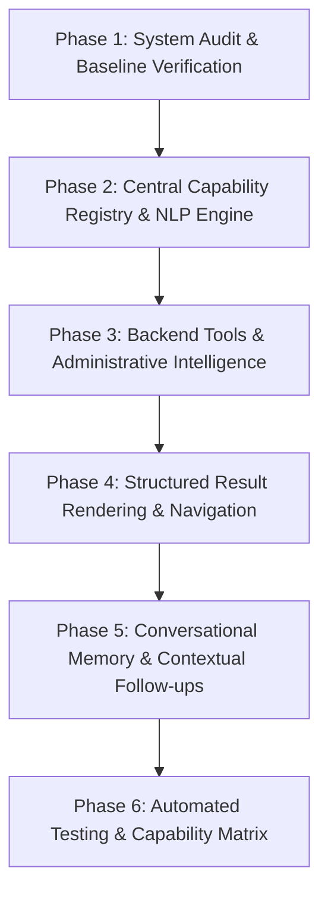

# ATLAS AI Assistant — System Audit & Technical Blueprint

**Date:** October 2026  
**System:** ATLAS POS & ERP Business Intelligence System  
**Audit Scope:** Full Application Frontend, Backend Services, SAP Service Layer, Role-Based Access Control (RBAC), and AI Assistant Orchestration Engine.

---

## 1. Executive Summary

This audit assesses the ATLAS Point-of-Sale (POS) and Enterprise Resource Planning (ERP) platform to guide the transformation of the existing chatbot into an enterprise-grade, context-aware **AI Business Assistant**. 

The assistant must understand natural-language business inquiries, resolve business intent and required parameters, strictly enforce permissions and branch scoping, perform deterministic calculations on real backend and SAP Business One data, render rich tables, charts, and KPI cards, and provide seamless internal navigation across the entire ATLAS dashboard.

---

## 2. Frontend Architecture & Module Inventory

The frontend is a single-page application built with React 19, TypeScript, Vite, React Router DOM (v6), TanStack React Query (v5), TailwindCSS, Recharts, and Lucide React icons.

### 2.1 Route Registry & Page Inventory

| Route Path | Page Component | Required Permission / Guard | Business Domain | Key Query Hooks & API Clients |
| :--- | :--- | :--- | :--- | :--- |
| `/` | `Dashboard` | `dashboard.view` | Executive KPIs, Sales Feed, Warehouse Distribution | `dashboardApi.getOverview`, `atlasApi.getOverview` |
| `/product` | `ProductLandingPage` | `products.view` | Product Showroom & Highlights | Static / Showcase |
| `/solutions` | `SolutionsLandingPage` | Module: `solutions` | ERP Operations & Enterprise Solutions | Showcase |
| `/products` | `ProductsStockPage` | `products.view` | Product Catalog, Barcode Lookup, Stock | `productsApi.getProducts`, `productsApi.getByBarcode` |
| `/products/:id` | `ProductsStockPage` | `products.view` | Detailed SKU Stock & Warehouse Breakdown | `productsApi.getProducts` |
| `/customers` | `CustomersPage` | `customers.view` | Customer Directory, Mobile Search, History | `customersApi.getCustomers` |
| `/pos` | `PosCheckoutPage` | `pos.access` | Point-of-Sale Billing Terminal | `posApi`, `productsApi`, `invoicesApi` |
| `/sales` | `SalesList` | `invoices.view` | AR Sales Invoices, Finalized Bills | `invoicesApi.getInvoices` |
| `/sales/:id` | `InvoiceDetail` | `invoices.view` | Individual Invoice Lines & Tax Details | `invoicesApi.getInvoiceDetail` |
| `/sales-orders` | `SalesOrdersPage` | `sales_orders.view` | Customer Sales Commitments & Fulfillment | `salesOrdersApi.getSalesOrders` |
| `/purchase-orders` | `PurchaseOrdersPage` | `purchase_orders.view` | Vendor Purchase Orders & Pending Goods | `purchaseOrdersApi.getPurchaseOrders` |
| `/returns` | `ReturnsApprovalsPage` | `returns.view` | Returns, Exchanges & Manager Approvals | `returnsApi.getReturns`, `approvalApi` |
| `/analytics` | `AtlasAnalyticsPage` | `dashboard.view` | Multi-Branch Comparison & Velocity Analytics | `atlasApi.getTrends` |
| `/production` | `ProductionOverviewPage` | `production.view` | Manufacturing KPIs, Batch Output Summary | `productionApi.getSummary` |
| `/production/orders`| `ProductionOrdersPage` | `production.orders.view` | SAP Production Orders & Due Dates | `productionApi.getOrders` |
| `/production/item-wise` | `ProductionItemWisePage`| `production.view` | Item Output, Target Completion Rates | `productionApi.getItemWise` |
| `/production/rejection` | `ProductionRejectionPage`| `production.view` | Scrap Tracking, Defect & Rejection % | `productionApi.getRejection` |
| `/production/date-wise` | `ProductionDateWisePage`| `production.view` | Date-Wise Production Output Trends | `productionApi.getDateWise` |
| `/production/reports` | `ProductionReportsPage` | `production.reports.view` | Exportable Production Summaries | `productionApi.getExport` |
| `/finance` | `FinanceOverviewPage` | `finance.view` | High-level Financial KPIs & Cash Flow | `financeApi.getOverview` |
| `/finance/purchase-invoices` | `PurchaseInvoicesPage` | `finance.invoices.view` | AP Purchase Invoices & Vendor Dues | `financeApi.getPurchaseInvoices` |
| `/finance/incoming-payments` | `IncomingPaymentsPage` | `finance.payments.view` | Customer Collections & Method Split | `financeApi.getIncomingPayments` |
| `/finance/outgoing-payments` | `OutgoingPaymentsPage` | `finance.payments.view` | Vendor Disbursements & Outgoing Transfers | `financeApi.getOutgoingPayments` |
| `/finance/customer-analysis` | `CustomerAnalysisPage` | `finance.view` | Customer Revenue, Aging & Outstanding AR | `financeApi.getCustomerRanking` |
| `/finance/supplier-analysis` | `SupplierAnalysisPage` | `finance.view` | Supplier Volume, Payables & AP Balances | `financeApi.getSupplierRanking` |
| `/finance/profitability-reports` | `ProfitabilityReportsPage`| `finance.reports.view` | Net Revenue, Cost of Goods, Gross Margin | `financeApi.getProfitability` |
| `/reports` | `ReportsPage` | `reports.view` | Central Reports Hub & Exporter | `reportsApi.exportReport` |
| `/reports/sales` | `SalesReportPage` | `reports.view` | Analytical Sales Reports & Period Trends | `reportsApi.getSales` |
| `/reports/invoice` | `InvoiceReportPage` | `reports.view` | Invoice Tax & Settlement Details | `reportsApi.getInvoices` |
| `/reports/payment` | `PaymentReportPage` | `reports.view` | Payment Method Split (Cash, Card, UPI) | `paymentsReportApi.getSummary` |
| `/reports/inventory` | `InventoryReportPage` | `reports.view` | Stock Valuation & Movement Reports | `inventoryReportApi.getOverview` |
| `/reports/customer` | `ReportPlaceholderPage` | `reports.view` | Customer Aging & Retention Reports | Pending SAP mapping |
| `/reports/ai` | `ReportPlaceholderPage` | `reports.view` | AI Generated Business Summaries | `aiAssistantApi` launcher |
| `/settings` | `SettingsUsersPage` | `requireAdmin=true` | User Management, Roles & Permission Matrix| `adminApi.getUsers`, `adminApi.getRoles` |
| `/contact` | `ContactPage` | Authenticated | Support, Documentation & Feedback | Direct |

---

## 3. Backend Architecture & Service Inventory

The backend is built with FastAPI (Python 3.12), PostgreSQL (user and audit database), and an HTTP SAP Business One Service Layer adapter with retry, circuit breaker, and timeout mechanisms.

### 3.1 FastAPI API Routers & Protection

| Router | Prefix | Authentication & RBAC Dependency | Key Functions |
| :--- | :--- | :--- | :--- |
| `auth.py` | `/api/v1/auth` | Public / Token Refresh | Login, Session Refresh, Token Revocation |
| `admin.py` | `/api/v1/admin` | `require_admin` / `users.manage` | User CRUD, Role Permissions, Session Invalidation |
| `dashboard.py` | `/api/v1/dashboard`| `dashboard.view` | High-level Sales, Revenue, Product Velocity, Stock |
| `atlas.py` | `/api/v1/atlas` | `dashboard.view` | Multi-branch analytics, trend graphs, branch scoping |
| `products.py` | `/api/v1/products` | `products.view` | SKU catalog, barcode lookup, warehouse stock |
| `customers.py` | `/api/v1/customers`| `customers.view` | Business Partner lookup, search, mobile indexing |
| `sales.py` | `/api/v1/sales` | `invoices.view` | AR Invoices, line items, payments |
| `sales_orders.py` | `/api/v1/sales-orders` | `sales_orders.view` | Customer sales orders, statuses |
| `purchase_orders.py` | `/api/v1/purchase-orders`| `purchase_orders.view` | Vendor purchase orders, pending receipts |
| `returns.py` | `/api/v1/returns` | `returns.view`, `returns.approve` | Return requests, manager approval workflow |
| `production.py` | `/api/v1/production` | `production.view`, `production.orders.view` | Work orders, rejection analysis, item/date aggregation |
| `finance.py` | `/api/v1/finance` | `finance.view`, `finance.invoices.view` | Overview, AR/AP aging, payments, profitability |
| `inventory_report.py`| `/api/v1/inventory-report` | `reports.view` | Warehouse inventory valuation & categories |
| `payments_report.py` | `/api/v1/payments-report` | `reports.view` | Payment method breakdown & settlement |
| `ai.py` | `/api/v1/ai` | `get_current_user` | Natural-language query orchestrator & tools |

### 3.2 SAP Service Layer Services

- `SAPInvoicesService`: AR invoices, customer sales, item lines, payment statuses.
- `SAPSalesOrdersService`: Sales orders, order lines, open/closed document status.
- `SAPPurchaseOrdersService`: Purchase orders, open quantities, supplier tracking.
- `SAPInventoryService`: Current warehouse stock, low-stock threshold queries.
- `SAPItemsService`: Product catalog, item barcodes, descriptions.
- `SAPBusinessPartnersService`: Customers & Vendors (CardCode, CardName, Phone, Balance).
- `SAPReturnsService`: AR Credit Memos and return requests.
- `SAPProductionService`: Work orders, status breakdown, completed and rejected quantities.
- `SAPFinanceService`: Financial overview, AP purchase invoices, incoming/outgoing payments, receivables/payables aging, gross margin & profitability.
- `SAPPaymentsReportService`: Method-wise incoming payment aggregations.
- `SAPWarehousesService`: Warehouse listing and branch metadata.

---

## 4. Current AI Assistant Implementation Audit

### 4.1 Strengths & Baseline Assets
1. **Existing Orchestrator**: `AIAssistantService` in `app/services/ai_service.py` provides an OpenAI SDK-compatible tool-calling loop with timeouts (40s backend limit) and timing logs.
2. **Standard Permissions**: `TOOL_PERMISSIONS` dictionary enforces authorization checks before tool execution.
3. **Branch Isolation**: `_get_permitted_branch()` enforces warehouse scoping (Admin: all or filtered; Manager: locked to assigned branch; User: assigned branch).
4. **Rich Visual Renderer**: `RichTableChartRenderer.tsx` and `AIChatRenderer.tsx` support KPI cards, interactive tables, and charts (Bar, Line, Area, Pie).
5. **Route Registry**: `routeRegistry.ts` ensures safe path resolution without arbitrary navigation.

### 4.2 Gaps Identified for System-Wide Upgrade
1. **Capability Registry**: No central machine-readable registry exists connecting NLP intents, permissions, required parameters, schema contracts, and routes across all ATLAS modules.
2. **Settings & Admin Intelligence**: The AI assistant currently lacks tools to answer administrative questions (e.g., "Which employees can edit products?", "Find user by username/email", "What can I access with my current permissions?") while respecting strict privacy boundaries.
3. **Reports Discovery**: No dedicated tool or structured intent exists for "Show all available reports" or navigating to specific report views with pre-applied date filters.
4. **Production Rejection Reporting**: While raw rejection data is fetched by `get_production_rejection`, it does not format into a full interactive analytical table with charting when asked as "Create a report showing production rejection by item".
5. **Contextual Memory & Follow-ups**: Follow-up questions ("Compare with last month", "Only for this branch", "Show the top five") rely heavily on LLM chat history rather than structured state tracking across turns.
6. **Test Baseline**: One test in `test_ai_assistant.py` and one in `test_finance_ai.py` failed due to missing default permissions on mock users and expected error wording.

---

## 5. Phased Implementation Plan

### Phase Details:
- **Phase 1**: Complete system audit document (`AI_ASSISTANT_SYSTEM_AUDIT.md`) and verify existing test baselines.
- **Phase 2**: Implement central capability registry (`app/core/capability_registry.py` and `src/utils/capabilityRegistry.ts`) with typed intents, parameter schemas, permissions, and route bindings. Build NLP parsing pipeline.
- **Phase 3**: Extend backend tools:
  - Add `get_admin_user_info` (admin-only: lookup users, roles, feature permissions).
  - Add `get_my_permissions` (employee self-service: effective permissions and module access).
  - Add `get_available_reports` (catalog of all system reports and routes).
  - Extend `get_analytical_table` to support `production_rejection` and `production` metrics.
  - Fix test baseline issues in `ai_service.py`.
- **Phase 4**: Upgrade frontend chat rendering:
  - Add view switcher (Table, Chart, Both).
  - Expand route registry to cover all Finance, Production, and Report pages.
  - Implement actionable navigation buttons preserving chat state.
- **Phase 5**: Enable structured multi-turn conversation memory tracking active metric, date range, branch, and filters across follow-up queries.
- **Phase 6**: Add comprehensive automated tests across NLP, permissions, branch isolation, and report generation, culminating in `AI_ASSISTANT_CAPABILITY_MATRIX.md`.
