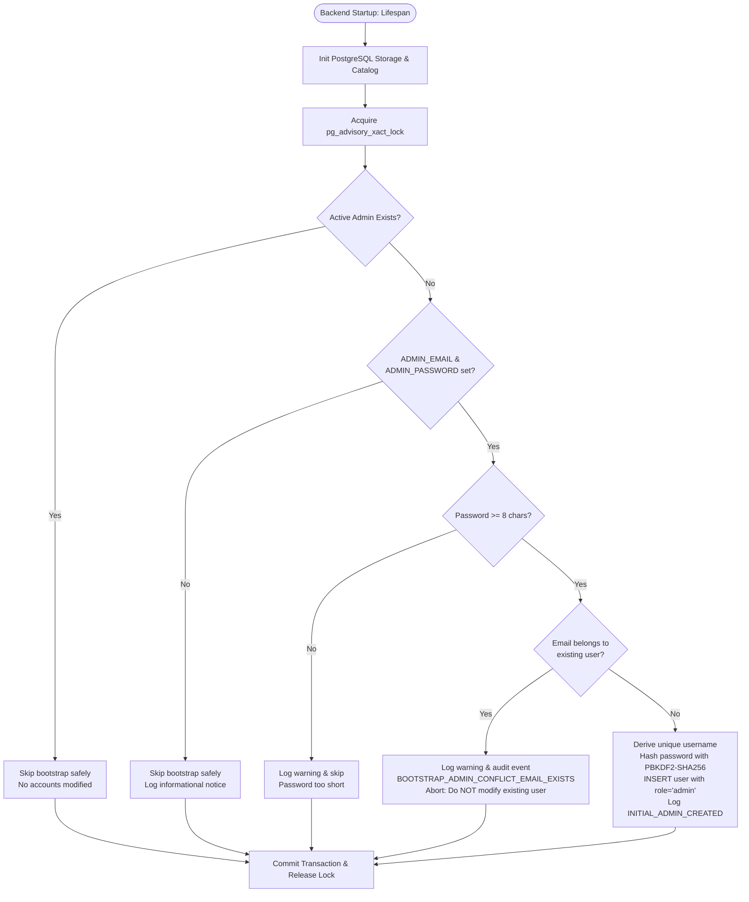

# ATLAS — Initial Administrator Setup & Security Guide

## 1. Executive Summary & Architecture Principles

The ATLAS POS, Inventory, Sales, Production, and Finance system implements an environment-driven, safe, and idempotent **Initial Administrator Setup**.

### Core Security Invariants
1. **Credentials Isolation**: `ADMIN_EMAIL` and `ADMIN_PASSWORD` are defined **exclusively** in the backend `.env` file. They are never exposed via API endpoints, never bundled into frontend JavaScript (`VITE_*`), never printed in log files, and excluded from version control (`.gitignore`).
2. **Zero Hardcoded Credentials**: Insecure hardcoded defaults (such as previous fallbacks like `AtlasAdmin#2026`) have been completely eliminated from the codebase.
3. **Idempotent & Safe Startup**: Automatic creation executes **strictly once** when no active administrator exists in PostgreSQL. If an active administrator account already exists, application startup skips initial bootstrap immediately with zero modifications to any user or password.
4. **Collision & Role Protection**: If `ADMIN_EMAIL` matches an existing non-admin user account (such as an operator or cashier), the system **strictly aborts** creation and records a security audit event. It will never automatically escalate an employee's role or overwrite their password.
5. **Concurrency Safety**: Worker processes acquire a PostgreSQL transaction-scoped advisory lock (`pg_advisory_xact_lock`) to serialize startup and prevent race conditions or duplicate administrator creations across multiple Uvicorn workers.
6. **PBKDF2-SHA256 Cryptography**: Passwords are saved only as secure PBKDF2-SHA256 hashes generated by `passlib.context.CryptContext`.
7. **Database-Driven Authorization**: Administrators and employees use the exact same login screen. Roles, permissions, and session tokens are resolved strictly from PostgreSQL; no administrative privilege is ever granted based on email address substrings or client-side flags.
8. **Finance Safety Policy**: SAP Service Layer write operations remain strictly disabled (`FINANCE_WRITEBACK_ENABLED=False`) by default.

---

## 2. Backend Configuration

Configuration is managed via Pydantic Settings in `app/core/config.py` and read exclusively from `pos-backend/.env`.

### Environment Variables

Add the following variables to `pos-inventory/pos-backend/.env` (see also `.env.example`):

```ini
# ==============================================================================
# Initial Administrator Setup (Backend .env only)
# Used strictly once when no active administrator exists in the database.
# Changing these values after initialization will NOT overwrite or reset the administrator password.
# ==============================================================================
ADMIN_EMAIL=admin@atlas.local
ADMIN_PASSWORD=ChangeMeStrongPassword!2026

# Optional Overrides:
ADMIN_USERNAME=admin
ADMIN_NAME=System Administrator
```

### Parameter Specification

| Variable | Required | Default | Description |
| :--- | :--- | :--- | :--- |
| `ADMIN_EMAIL` | **Yes** (for bootstrap) | `""` | Dedicated administrator email address used for login and notifications. |
| `ADMIN_PASSWORD` | **Yes** (for bootstrap) | `""` | Administrator password. Minimum 8 characters. Marked `repr=False` in Pydantic to prevent leakages in debug dumps. |
| `ADMIN_USERNAME` | No | Prefix of `ADMIN_EMAIL` | Unique system username for the admin account. |
| `ADMIN_NAME` | No | `"System Administrator"` | Display name for the initial administrator. |

> [!IMPORTANT]
> If either `ADMIN_EMAIL` or `ADMIN_PASSWORD` is omitted or empty, automatic administrator creation skips safely without crashing the backend.

---

## 3. Safe Initial Admin Creation Lifecycle

Automatic bootstrap is handled during backend lifespan startup in `app/services/user_service.py::ensure_bootstrap_admin()`.



### Detailed Decision Steps:
1. **Advisory Lock Acquisition**:
   Executes `SELECT pg_advisory_xact_lock(hashtext('atlas_admin_bootstrap'))`. In multi-process deployments (e.g. 4 Uvicorn workers), only one worker enters the bootstrap critical section at a time.
2. **Existing Admin Check**:
   Executes `SELECT COUNT(*) FROM users WHERE LOWER(role) IN ('admin', 'administrator') AND is_active = TRUE`. If `count > 0`, execution terminates immediately. Existing admins, passwords, and permissions remain untouched.
3. **Environment Credentials Validation**:
   Verifies that `ADMIN_EMAIL` and `ADMIN_PASSWORD` are non-empty and that `len(ADMIN_PASSWORD) >= 8`.
4. **Email Collision Prevention**:
   Checks whether `ADMIN_EMAIL` matches any existing account in the `users` table. If a match is found:
   - The backend **refuses** to modify the user.
   - The user's role is **not** promoted.
   - The user's password is **not** overwritten.
   - A `BOOTSTRAP_ADMIN_CONFLICT_EMAIL_EXISTS` security event is written to `security_audit_logs`.
5. **Transactional Creation**:
   Creates the admin record with `role="admin"`, `is_active=True`, and `token_version=1`.
6. **Security Audit Log**:
   Writes an `INITIAL_ADMIN_CREATED` audit log containing the timestamp, username, email, and source (`backend_env_bootstrap`). Passwords and password hashes are **never** recorded in logs.

---

## 4. Unified Login Behavior

The application maintains a **single, unified login page** for both administrators and regular employees at `/login`.

### Login Flow
1. User enters their identifier (either their `email` or `username`) and password.
2. Frontend dispatches `POST /api/v1/auth/login` with payload `{"email": "...", "password": "..."}` or `{"username": "...", "password": "..."}`.
3. Backend executes case-insensitive lookup:
   ```sql
   SELECT id, username, email, name, password_hash, role, sap_user_code,
          branch_id, store_name, created_at, is_active, token_version
   FROM users
   WHERE LOWER(username) = LOWER(%s) OR LOWER(email) = LOWER(%s)
   LIMIT 1
   ```
4. If the account is deactivated (`is_active = FALSE`), backend rejects with `401 Unauthorized` (`ACCOUNT_DEACTIVATED`).
5. Password is verified against the stored hash using `verify_password(password, user["password_hash"])`.
6. Role and permissions are loaded from PostgreSQL:
   - For `role="admin"`, full administrative permissions catalog (`users.manage`, `roles.manage`, `permissions.manage`, `settings.view`, etc.) is loaded.
   - For employees, effective permissions are resolved from role presets merged with any custom user grants/revocations in `user_permissions`.
7. Backend signs a signed JWT containing claims: `sub`, `email`, `role`, `user_id`, `branch_id`, `store_name`, `token_version`.
8. Frontend `AuthContext` initializes `currentUser` and `isAdmin` based strictly on the verified JWT payload returned by the server.

---

## 5. Admin Password Rotation & Ongoing Management

> [!WARNING]
> **Modifying `ADMIN_PASSWORD` in `.env` will NOT reset or change an existing administrator's password.**
> Because `ensure_bootstrap_admin()` is strictly idempotent and skips when an active admin exists, modifying `.env` after initial creation has zero effect on existing database records. This prevents accidental credential resets or security regressions upon container restarts.

### Method A: Password Rotation via Admin UI (Recommended)
1. Log in to ATLAS as an Administrator.
2. Navigate to **Settings** (`/settings`) -> **Users & Roles** (`/settings/users`).
3. Locate the Administrator account in the users table and click **Edit User** (Pencil Icon).
4. Enter the new secure password in the **Password** field.
5. Click **Save Changes**.
6. The backend updates the password hash using PBKDF2-SHA256, increments `token_version` by 1 to invalidate all existing sessions across devices, and logs a `USER_UPDATED` security audit event.

### Method B: Password Rotation via CLI Script
When web UI access is unavailable, an authorized systems administrator with shell access to the host server can rotate credentials using `scripts/bootstrap_admin.py`:

```powershell
cd "c:\Users\A\Documents\IB\Dashboard\New Dashboard\Atls\pos-inventory\pos-backend"
python scripts/bootstrap_admin.py --username admin --email admin@atlas.local
```
The script securely prompts for the new password with hidden input and confirmation:
```text
Enter secure admin password:
Confirm secure admin password:
Success: User 'admin' promoted to administrator and password reset.
```

---

## 6. Disaster Recovery & Emergency Break-Glass Procedure

If all administrator credentials are lost, forgotten, or locked out, follow this emergency recovery procedure:

### Step 1: Access the Backend Host
Log in to the server hosting the `pos-backend` service with administrator/root privileges.

### Step 2: Run the Interactive Bootstrap CLI
Execute the bootstrap script in interactive mode:
```powershell
python scripts/bootstrap_admin.py --interactive
```
Follow the interactive prompts:
```text
Enter admin username: recovery_admin
Enter admin email: recovery@atlas.local
Enter admin full name [System Administrator]: Emergency Recovery Admin
Enter secure admin password: [HIDDEN]
Confirm secure admin password: [HIDDEN]
```
If the account already exists, its password will be safely reset and its status set to active admin. If it does not exist, a new dedicated active administrator is created.

### Step 3: Verify Security Audit Trail
Query the PostgreSQL audit log to review the recovery event:
```sql
SELECT id, username, action, resource_id, details, created_at
FROM security_audit_logs
WHERE action IN ('ADMIN_BOOTSTRAP_PROMOTED', 'ADMIN_BOOTSTRAP_CREATED', 'INITIAL_ADMIN_CREATED')
ORDER BY created_at DESC
LIMIT 5;
```

---

## 7. Security Protections & Operational Safeguards

| Threat Vector | Mitigation Mechanism | Verification Test |
| :--- | :--- | :--- |
| **Credential Exposure** | Credentials read strictly from backend `.env`. `ADMIN_PASSWORD` marked with `repr=False`. Omitted from Git and frontend builds. | Configuration inspect & build scan |
| **Duplicate Admin Race Condition** | `pg_advisory_xact_lock(hashtext('atlas_admin_bootstrap'))` serializes concurrent worker startups. | `test_concurrent_bootstrap_safety` |
| **Silent Password Overwrites** | `ensure_bootstrap_admin()` skips immediately if `_count_active_admins > 0`. Modifying `.env` does not alter database. | `test_existing_admin_protection` |
| **Employee Privilege Escalation** | If `ADMIN_EMAIL` matches an existing user, creation aborts without changing role or credentials. | `test_existing_employee_email_conflict` |
| **Weak Password Risk** | Passwords must be at least 8 characters; shorter passwords are rejected safely during bootstrap. | `test_short_admin_password_skips_safely` |
| **Unauthorized Endpoint Access** | Role and permission checks enforced on all `/api/v1/admin/*` endpoints via `require_admin` dependency. | `test_employee_permission_restrictions` |
| **Session Invalidation** | Password or permission updates increment `token_version`, immediately invalidating stale JWTs. | `test_session_revocation_and_logout` |
| **SAP Financial Mutation** | `FINANCE_WRITEBACK_ENABLED=False` is enforced at the backend kernel. Write requests return 403 Forbidden. | `test_finance_writeback_remains_strictly_disabled` |

---

## 8. Verification & Test Evidence

All tests pass 100% across backend API suites and frontend client builds:

### Backend Test Execution
```powershell
python -m pytest tests/test_initial_admin_setup.py tests/test_auth_rbac.py tests/test_finance_safety.py tests/test_api.py -v
```
**Results:** `51 passed in 12.57s`
- `tests/test_initial_admin_setup.py`: 10 passed (Missing env vars, short password, existing admin protection, brand-new creation, email conflict protection, concurrent advisory locking, email/username login, invalid credentials, employee restrictions, finance write-back disabled).
- `tests/test_auth_rbac.py`: 9 passed (Admin login lifecycle, admin vs employee endpoints, granular grants/denials, view vs edit separation, last admin protection, session revocation, registration role clamping, AI assistant permission gating, branch boundaries).
- `tests/test_finance_safety.py`: 10 passed (Submit endpoint blocked, all roles rejected, write tool excluded from AI schema, overview and audit read-only endpoints operational).
- `tests/test_api.py`: 22 passed (Health checks, image proxying, pagination limits, caching, and SAP read resilience).

### Frontend Test & Build Execution
```powershell
npm test -- --run
npm run build
```
**Results:**
- `Vitest`: `51 passed in 963ms` (Route registry, permission gates, table/chart renderers, navigation layout).
- `TypeScript & Vite Build`: `✓ built in 7.62s` (Production bundle generated without errors).
