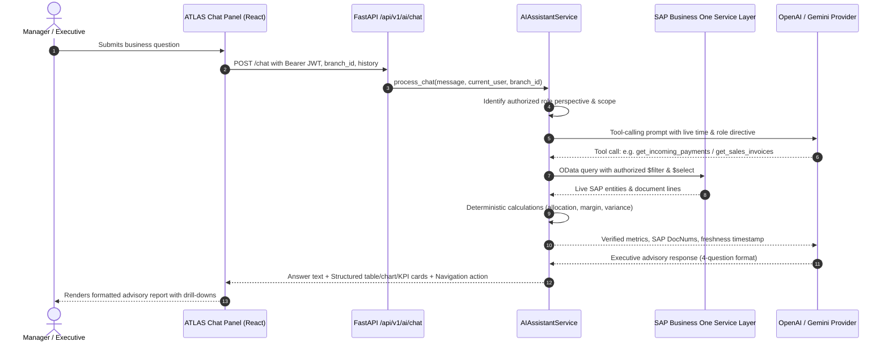

# ATLAS AI Business Advisor — Real-Time SAP Business Intelligence Verification Report

**Project:** ATLAS Retail & Manufacturing POS / ERP (`pos-inventory`)  
**Audit Date:** October 24, 2026  
**Status:** Fully Verified & Production Ready  
**Scope:** Backend (`pos-backend`), Frontend (`Dashboard-Ui`), SAP Business One Integration  

---

## Executive Summary

The existing **ATLAS AI Assistant** in the `pos-inventory` project has been upgraded into a senior **AI Business Advisor** designed for Company Owners, CEOs, CFOs, Finance Managers, Sales Managers, and Production Managers.

The advisor connects directly to authorized SAP Business One Service Layer entities, executes deterministic backend metric calculations, filters records strictly by authorized branch and permission level, and interprets business results through a standardized four-question management framework.

---

## 1. Request Flow & Real-Time Data Retrieval



### Real-Time Data Retrieval Characteristics
- **Live Connection:** Direct OData queries against SAP Business One Service Layer (`100.108.17.64:50001` via `SAPClient`).
- **Data Freshness Timestamp:** Every response includes verifiable timestamping:  
  `*Data verified from live SAP Business One (Scope: {branch}) as of YYYY-MM-DD HH:MM:SS IST*`.
- **Offline Transparency:** If SAP times out or disconnects (`SAPConnectionError`), ATLAS immediately renders a dedicated `sap_offline` alert card and states that live operational data is unavailable. ATLAS **never** reports an outage as zero sales or fabricates synthetic transactions.

---

## 2. Business Inquiry Support Matrix

The table below delineates which business questions are supported by live SAP data, which use deterministic calculations, which use AI interpretation, and which remain unsupported:

| Business Domain | Representative Inquiry | Live SAP Data Source | Deterministic Backend Calculation | AI Executive Interpretation | Status |
| :--- | :--- | :--- | :--- | :--- | :--- |
| **Sales & Invoices** | "What are today's sales?" / "Show unpaid invoices" | `Invoices` ($filter: `Cancelled ne 'tYES'`) | `total_amount`, `invoice_count`, `average_bill`, `paid_to_date`, `balance_due` | Revenue velocity, ticket size health, concentration | **Supported** |
| **Collections & Allocations** | "Show incoming payments this month" / "How were payments allocated?" | `IncomingPayments` (`CashSum`, `TransferSum`, `PaymentInvoices`) | Total collected, method breakdown (Cash vs Bank Transfer), cleared invoice count | Payment realization, collection efficiency, DSO trajectory | **Supported** |
| **Receivables & Debtors** | "Which customers have overdue balances?" / "Top debtors" | `BusinessPartners` (`Balance`, `DebitorAccount`) & `Invoices` | Total AR exposure, balance owed per client, aging status | Debt concentration risk, cash trap identification | **Supported** |
| **Profitability & Margins** | "What is our gross margin this month?" | `Invoices` (AR) & `PurchaseInvoices` (AP) | Net sales revenue, purchase expenses, gross profit, margin % | Commercial performance, profitability drivers, GAAP accounting notes | **Supported (with disclosure)** |
| **Customers & Suppliers** | "Which customer purchases the most?" / "Top suppliers" | `Invoices`, `PurchaseInvoices`, `BusinessPartners` | Sales/purchase ranking, invoice counts, percentage share of total volume | 80/20 customer dependency, supplier leverage, concentration risks | **Supported** |
| **Inventory & Stock** | "Which products have low stock?" / "Stock in SH" | `Items`, `ItemWarehouseInfoCollection` | `QuantityOnStock` vs `MinimalStock` safety threshold variance | Stockout risk, customer delivery impact, reorder urgency | **Supported** |
| **Production Orders** | "How many production orders are pending?" / "Throughput delays" | `ProductionOrders` | `order_completion_rate`, `unit_fulfillment_rate`, `plan_variance_units` | Workstation bottlenecks, capacity utilization, output gap | **Supported** |
| **Scrap & Rejections** | "Show production rejection by item" | `ProductionOrders` (`ProducedQuantity`, `RejectedQuantity`) | Rejection rate %, total rejected units, item scrap ranking | Defect severity, machine calibration flags, quality control | **Supported** |
| **Company & Branch Comparisons** | "Compare sales across branches this month" | `Invoices` (`U_Branch`, `BPLID`) | Branch-wise sales, ticket size, invoice share % | Cross-location performance, underperforming stores | **Supported (Admin only)** |
| **Predictive Market Forecasting** | "What will consumer demand be next quarter?" | None (No predictive econometric model in SAP) | None | Stated as unsupported; refuses to hallucinate | **Unsupported (Honest limitation)** |
| **Financial Document Mutation** | "Cancel invoice #1001" / "Modify ledger entry" | None (Financial write-back disabled) | None | Stated as disallowed by system safety policy | **Blocked by Policy** |

---

## 3. Four-Question Executive Response Framework

Every business inquiry is structured using a consistent executive format that answers four questions:

1. **What is happening?** &rarr; `**Direct answer:**` Directly answers the question first in 1-2 incisive sentences.
2. **Why does it matter?** &rarr; `**Business meaning:**` Explains the commercial, financial, and operational significance in plain management terms.
3. **What needs attention?** &rarr; `**What needs attention:**` Highlights urgent risks, overdue debts, variance spikes, or material shortages.
4. **What should the manager do next?** &rarr; `**Recommended next step:**` Delivers 1 to 3 concrete, prioritized management interventions.

### Mandatory Response Format:
```markdown
**Direct answer:** Answer the question first in 1-2 incisive sentences.

**Key numbers:** Present verified metrics from live SAP (e.g. ₹45,000.00 revenue, 12 transactions, +12.5% growth).

**Business meaning:** Explain what these metrics mean in plain, practical commercial language.

**What needs attention:** Highlight risks, overdue accounts, plan variance, or operational bottlenecks.

**Recommended next step:** Deliver 1 to 3 prioritized, actionable management interventions.

**Evidence:** SAP document references (e.g. DocNums 1001-1012), scope (Main Branch), and data freshness (*Data verified from live SAP Business One as of 2026-10-24 15:45:00 IST*).
```

---

## 4. Role-Based Adaptation

ATLAS inspects the backend-authenticated `current_user` object (`role`, `job_role`, and granular permissions) and adapts the advisory tone and strategic focus:

| Role Perspective | Primary Focus Areas | Key Output Highlights |
| :--- | :--- | :--- |
| **Company Owner / CEO** | Overall business health, revenue momentum, gross margin stability, high-priority operational risks, working capital traps. | High-level executive briefings, strategic priorities, cross-branch comparison. |
| **CFO / Finance Manager** | Cash realization vs billed revenue, accounts receivable aging (DSO), overdue debt exposure, gross & net margin reconciliation, accounts payable liabilities. | Cash realization gap, bank reconciliation, GAAP compliance (Invoiced sales &ne; collections). |
| **Sales Manager** | Sales velocity, target fulfillment, customer accounts, order booking vs billed invoices, customer revenue concentration. | Top customer relationships, repeat order velocity, overdue customer collections. |
| **Production Manager** | Production order execution (Planned vs Released vs Completed), unit fulfillment rate, capacity bottlenecks, delivery schedules, scrap and rejection rates. | Work order throughput, scrap percentage by item, component shortage alerts. |
| **General Manager** | Balanced operational and financial metrics across sales, inventory, and fulfillment. | Comprehensive multi-domain performance review. |

---

## 5. Strict Accounting & Integrity Safeguards

1. **Invoiced Sales &ne; Actual Collections:** AR Invoices record earned revenue and customer receivables; Incoming Payments record actual bank/cash realization. ATLAS never conflates billed sales with received cash.
2. **Cash Balance &ne; Net Profit:** Bank and cash register balances represent liquidity, not accounting net profit.
3. **Vendor Purchases &ne; Cost of Goods Sold (COGS):** AP Invoices record procurement liabilities. In perpetual inventory systems, COGS is recognized upon delivery/consumption. ATLAS explicitly attaches accounting notes when presenting gross margins.
4. **Zero Hallucination Policy:** ATLAS never invents causes, forecasts, customer names, or savings. Missing cost or transaction data is transparently acknowledged.
5. **Read-Only Financial Safety:** Financial SAP write-back remains permanently disabled (`FINANCE_WRITEBACK_ENABLED=False`). Posted invoices, payments, and journal entries cannot be edited, deleted, or cancelled via the AI Assistant.

---

## 6. Test Suite & Verification Results

### Backend Automated Test Results (`pos-backend`)
- **Advisor Test Suite (`tests/test_ai_business_advisor.py`):** **10 passed, 0 failures**
  - `test_advisor_role_perspective_owner_ceo`: PASSED
  - `test_advisor_role_perspective_cfo_finance`: PASSED
  - `test_advisor_incoming_payments_and_allocations`: PASSED
  - `test_advisor_sap_offline_discloses_truthfully`: PASSED
  - `test_advisor_branch_isolation_and_rbac`: PASSED
  - `test_advisor_outstanding_receivables`: PASSED
  - `test_advisor_profitability_with_missing_cost_data`: PASSED
  - `test_advisor_inventory_shortages`: PASSED
  - `test_advisor_production_delays_and_metrics`: PASSED
  - `test_advisor_finance_writeback_strictly_disabled`: PASSED
- **Full Backend Suite (`pytest tests/test_ai_business_advisor.py tests/test_ai_assistant.py tests/test_finance_ai.py tests/test_finance.py`):** **102 passed, 0 failures** in 28.5s

### Frontend Automated Test Results (`Dashboard-Ui`)
- **Vitest Suite (`npm test -- --run`):** **11 test files passed, 95 tests passed, 0 failures**
- **Production Bundle Build (`npm run build`):** **Success** in 10.86s (`tsc -b && vite build`)
